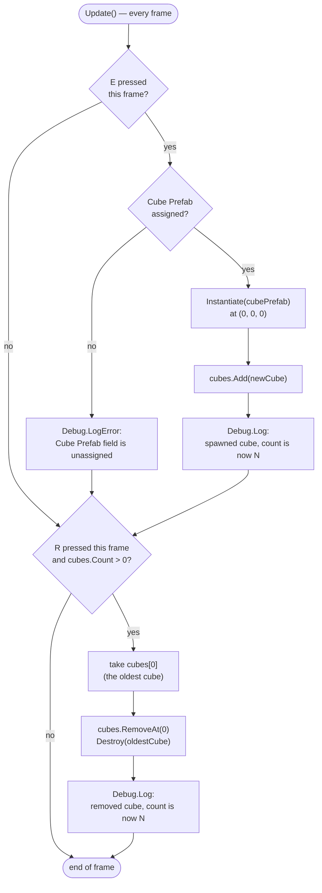
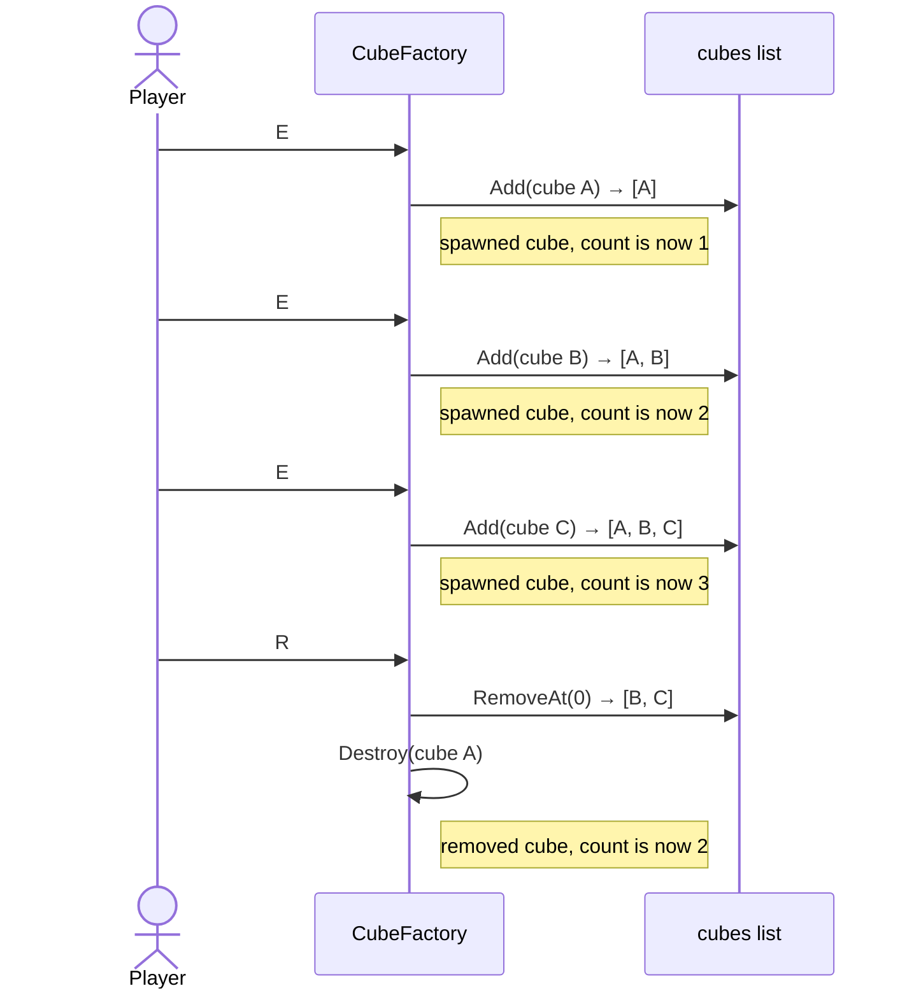
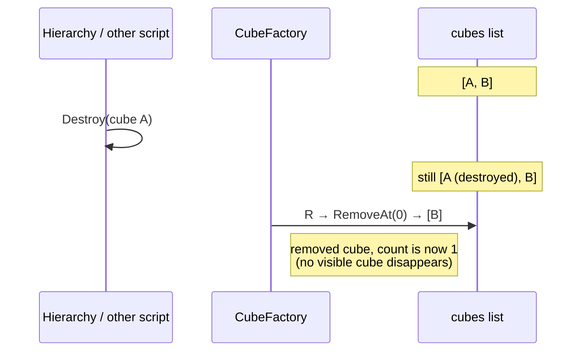

# Cube-Factory

This unity asset instantiates, keeps track of and removes cubes based on player input.

The diagram below shows what the component does each frame. It is drawn from
`src/CubeFactory.cs`; it is a diagram, not a screenshot of a running scene.

## Installation

This repository is a drop-in script, not a Unity project. There is no scene, no
`Assets/` folder and no package manifest here — only the single `MonoBehaviour` in
`src/`.

1. Copy `src/CubeFactory.cs` into the `Assets/` folder of an existing Unity project.
2. Let Unity finish compiling; the `CubeFactory` component becomes available.

The script reads the keyboard through the legacy `UnityEngine.Input` API. The
project's **Active Input Handling** setting (Project Settings → Player → Other
Settings) must be `Input Manager (Old)` or `Both`; with `Input System Package (New)`
alone, that API is not serviced and neither key is read.

## Setup

1. Create a cube prefab (for example, from a built-in `Cube` GameObject).
2. Add an empty GameObject to the scene.
3. Attach the `CubeFactory` component to it.
4. Assign the cube prefab to the component's **Cube Prefab** field in the Inspector.

The **Cube Prefab** field has no default value. If it is left unassigned, pressing
`E` spawns nothing and writes an error to the Console naming the field to assign.

## Controls

| Key | Action |
|-----|--------|
| `E` | Spawns a cube and adds it to the tracked list |
| `R` | Destroys one tracked cube, if any remain |

Both keys are handled in `Update()` and are read once per key press, not per frame
held.

## Behaviour

- Every cube is spawned at the world origin, `(0, 0, 0)`. Spawning several cubes
  therefore produces a stack of overlapping cubes at the same point rather than a
  visible spread.
- `R` removes the **oldest** cube still tracked, not the most recently spawned one.
- Pressing `R` with no cubes tracked does nothing.
- The component only updates the tracked list when `E` or `R` handles a cube. A cube
  destroyed any other way, such as from the Hierarchy or by another script, keeps its
  entry, so it still counts towards the logged count. When `R` reaches that entry it
  removes the entry, but no visible cube disappears.
- After each spawn and each removal, a labelled message naming the action and the
  resulting cube count is written to the Console — for example
  `CubeFactory: spawned cube, count is now 1`.
- Pressing `E` while **Cube Prefab** is unassigned logs an error naming the field
  and leaves the tracked list unchanged.

## Diagrams

### Tracked list order

`E` appends to the end of the `cubes` list and `R` removes from the front, so the
list behaves as a first-in, first-out queue. The sequence below traces three
presses of `E` followed by one press of `R`, with the Console line each press
writes.

### Cubes destroyed elsewhere

A cube destroyed outside the component (from the Hierarchy or another script)
keeps its entry in `cubes`, so the logged count still includes it until `R`
reaches that entry.

## Inspector fields

| Field | Type | Purpose |
|-------|------|---------|
| `cubePrefab` | `GameObject` | The prefab instantiated on each spawn. Must be assigned. |
| `cubes` | `List<GameObject>` | The cubes currently tracked. Populated at runtime; assigning it in the Inspector is not expected. |

## License

Licensed under the Stephenson Software Non-Commercial License (Stephenson-NC). See
[LICENSE](LICENSE).
